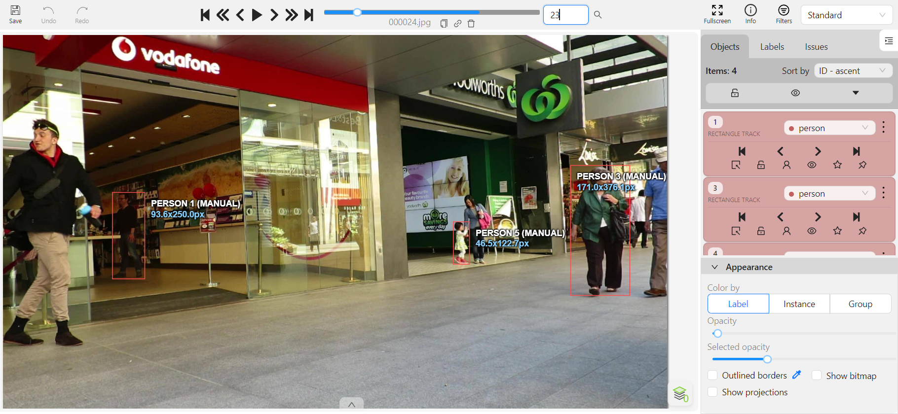
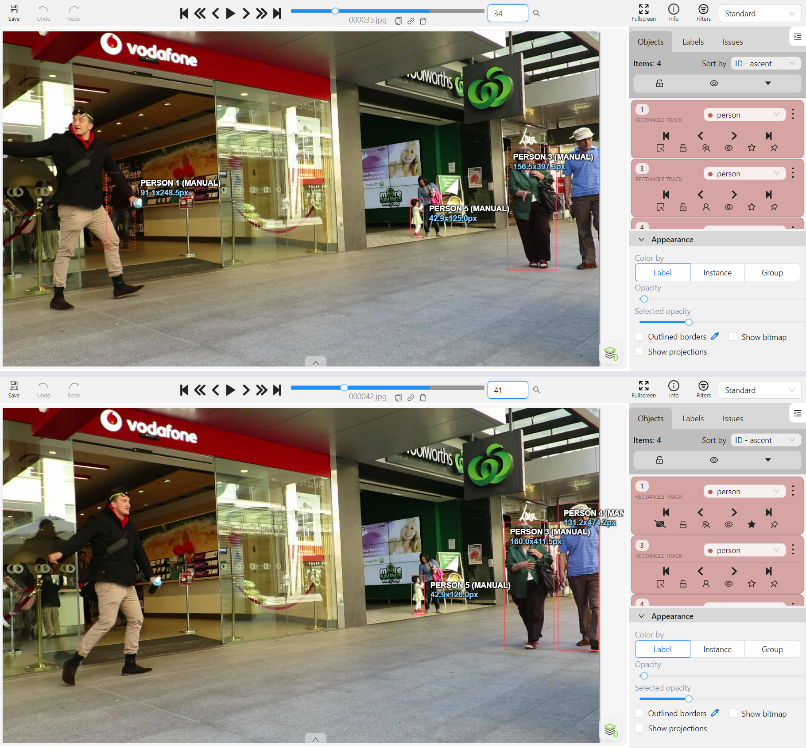
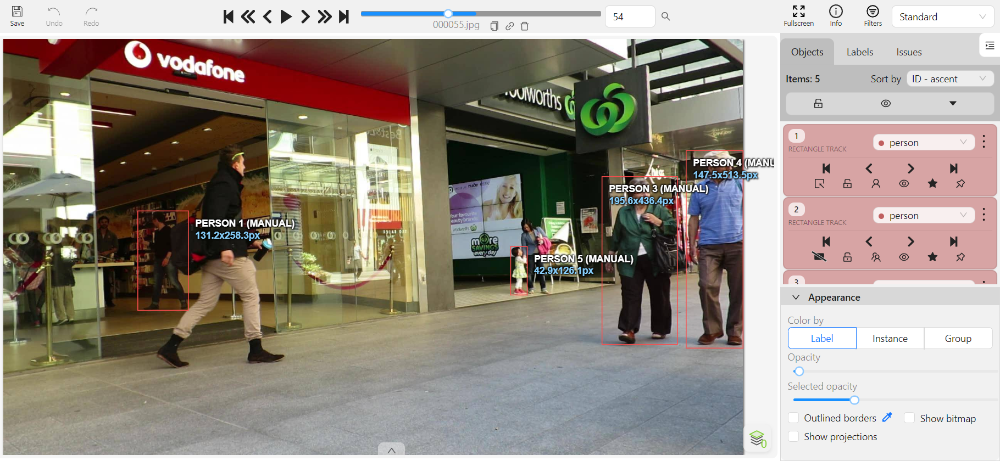

# Báo cáo cá nhân — LaThaiHoa-2A202603069

Đoạn video: MOT17-09, 150 frame (frame 1–150), nguồn MOTChallenge, giấy phép CC BY-NC-SA 3.0.

## 0. Thông tin học viên

- Họ tên: La Thái Hòa
- MSSV: 2A202603069
- Mã đề (A/B/C): A
- Email: 26ai.hoalt@vinuni.edu.vn
- Link repository: https://github.com/Zeus-AIE/K5-L2A-DAY05-LaThaiHoa-2A202603069-MOTTracking
- Giờ bắt đầu: 16:42 (GMT+7)
- Giờ kết thúc: 18:30 (GMT+7)

## 1. Xem trước đoạn video (CP0)

Ghi **trước khi vẽ**, mỗi người một dòng (số frame theo CVAT từ 0 đến 149).

| Mã | Frame xuất hiện | Frame cuối thấy được | Rẽ / dừng / đổi tốc độ ở frame | Bị che ở frame | Ghi chú |
|---|---:|---:|---|---|---|
| P1 | 0 | 149 | 20–30 (di chuyển từ quầy bên trái sang phải rồi hướng ra cửa), 60–149 (tiến thẳng ra cửa chính Vodafone, hộp lớn dần) | 30–40 & 46–53 (19 frame che một phần `occluded`), 41–45 (5 frame khuất hẳn `outside`) | Người đàn ông mặc áo len đen, quần jeans trong cửa hàng Vodafone (`PERSON 1` trên CVAT UI; XML Track 0 / MOT Track 1) |
| P2 | 60 | 149 | 60–74 (bước vào khung hình từ phía trong quầy/sau cửa Vodafone), 74–149 (đi đều ra phía cửa) | 60–65 (6 frame bị che một phần `occluded`) | Người xuất hiện ở nửa sau của đoạn trong khu vực Vodafone (`PERSON 2` trên CVAT UI; XML Track 1 / MOT Track 5) |
| P3 | 0 | 149 | 74–92 & 102–149 (đi bộ lại gần camera, kích thước hộp tăng nhanh) | Không bị che | Người phụ nữ lớn tuổi mặc áo khoác xanh lá đậm, quần đen, đeo túi đen (`PERSON 3` trên CVAT UI; XML Track 2 / MOT Track 2) |
| P4 | 40 | 149 | 40–61 (tiến rõ từ rìa phải vào khung hình), 94–149 (lại gần camera, kích thước hộp tăng mạnh) | Không bị che trong đoạn thấy được (40–149) | Người đàn ông lớn tuổi mặc áo polo xanh dương, đội mũ trắng, quần nâu đi bên phải P3 (`PERSON 4` trên CVAT UI; XML Track 3 / MOT Track 4) |
| P5 | 0 | 146 | 0–42 (đi chậm về phía trước cùng mẹ), 42–106 (gần như đi thẳng chậm đều) | 106–110, 136–139 & 143–146 (13 frame che một phần `occluded`), 111–135 & 147–149 (khuất hẳn `outside` sau P3 và P4) | Bé gái mặc váy trắng/xanh nhạt trước cửa hàng Woolworths (`PERSON 5` trên CVAT UI; XML Track 4 / MOT Track 3) |

## 2. Keyframe và thời gian (CP1, CP4)

Số keyframe lấy từ kết quả `src/check_submission.py`.

| Mã | Số keyframe | Keyframe ở frame | Số frame có mặt | Keyframe / 100 frame | Thời gian (phút) | Chỗ khó |
|---|---:|---|---:|---:|---:|---|
| P1 (`PERSON 1` / XML Track 0 / MOT Track 1) | 23 | 0, 10, 20, 30, 35, 40, 46, 50, 54, 57, 60, 61, 70, 79, 80, 90, 100, 110, 115, 120, 130, 140, 149 | 145 | 15.9 | 20 | Đoạn che khuất frame 30–53 và cần tinh gọn bớt các keyframe dư thừa sau khi kiểm tra từng frame |
| P2 (`PERSON 2` / XML Track 1 / MOT Track 5) | 19 | 60, 64, 66, 67, 68, 69, 70, 71, 72, 73, 74, 84, 94, 104, 114, 124, 134, 144, 149 | 90 | 21.1 | 12 | Đoạn mới lộ diện (frame 60–74) vừa bị che một phần vừa đổi tư thế nên cần cắm keyframe dày hơn |
| P3 (`PERSON 3` / XML Track 2 / MOT Track 2) | 33 | 0, 10, 20, 30, 40, 50, 60, 62, 70, 74, 75, 76, 77, 78, 79, 80, 82, 83, 84, 85, 86, 87, 88, 89, 90, 91, 92, 102, 112, 122, 132, 142, 149 | 150 | 22.0 | 15 | Đối tượng tiến sát camera, tốc độ đổi kích thước và vung tay/túi xách nhanh ở đoạn frame 74–92 |
| P4 (`PERSON 4` / XML Track 3 / MOT Track 4) | 32 | 40, 41, 42, 43, 44, 45, 46, 47, 48, 49, 50, 51, 52, 53, 54, 55, 56, 57, 58, 59, 60, 61, 70, 80, 90, 94, 104, 114, 124, 134, 144, 149 | 110 | 29.1 | 15 | Đoạn đầu frame 40–61 người này vừa bước từ mép phải khung hình vào vừa tăng kích thước nhanh |
| P5 (`PERSON 5` / XML Track 4 / MOT Track 3) | 14 | 0, 10, 20, 30, 31, 32, 42, 106, 107, 136, 140, 143, 144, 145 | 122 | 11.5 | 13 | Hộp kích thước nhỏ ở xa và bị P3, P4 che khuất hoàn toàn ở frame 111–135 trước khi lộ lại ở 136–146 |
| **Tổng** | **121** | | **617** | **19.6** | **75** | |

Keyframe / 100 frame của cả bài = tổng keyframe ÷ tổng số frame có mặt × 100 = 121 ÷ 617 × 100 = **19.6 keyframe / 100 frame**.

Bạn đặt keyframe nhiều nhất ở người nào? Vì sao (người đó rẽ, dừng, lại gần camera hay bị che)?

- Tôi đặt số lượng keyframe nhiều nhất ở **P3 (33 keyframe)** và **P4 (32 keyframe)**. Lý do là cả P3 và P4 đều đi bộ tiến thẳng về phía gần camera trong nửa sau của video (đặc biệt P3 ở đoạn frame 74–92 và P4 khi bước vào trọn khung hình ở frame 40–61), khiến vị trí tâm hộp và kích thước bounding box thay đổi phi tuyến rõ rệt nên cần đặt keyframe dày hơn để tránh trôi hộp.
- Tính theo mật độ trên 100 frame hiện diện, **P4 có mật độ cao nhất (29.1 KF / 100 frame)** do xuất hiện ở 110 frame cuối nhưng tập trung chỉnh tay nhiều ở đoạn mới bước từ biên ảnh vào (frame 40–61).

## 3. Đoạn bị che (CP2)

Người bị che: `P1`

| Mốc | Frame |
|---|---:|
| Bắt đầu bị che một phần (bật `occluded`) | 30 |
| Mất hẳn (bật `outside`) | 41 |
| Hiện lại (tắt `outside`) | 46 |
| Thấy rõ trở lại (tắt `occluded`) | 54 |

- Thời gian khuất hẳn: **5** frame (từ frame 41 đến hết frame 45) = **0,17** giây (ở 30 fps).
- Quyết định: **Giữ cùng ID** (`PERSON 1` trên CVAT UI / Track ID `1` trong MOT / Track `0` trong CVAT XML, tắt `outside` tại frame 46).
- Lý do (trả lời 3 câu: khuất bao lâu so với 60 frame, ngoại hình có khớp, chỗ hiện lại có đúng hướng và tốc độ):
  1. **Thời gian khuất so với ngưỡng 60 frame:** P1 chỉ khuất hoàn toàn trong **5 frame (0,17 giây)**, nhỏ hơn rất nhiều so với ngưỡng tối đa 60 frame (2 giây) của lớp.
  2. **Ngoại hình có khớp không:** Khi lộ diện trở lại ở frame 46, người này vẫn mặc đúng áo len dài tay màu đen, quần jeans tối màu và có cùng tỷ lệ cơ thể như trước khi bị che ở frame 40.
  3. **Chỗ hiện lại có đúng hướng và tốc độ không:** Vị trí xuất hiện ở frame 46 nằm ngay phía bên phải điểm khuất, tiếp nối đúng hướng di chuyển và vận tốc bước đi từ trong cửa hàng Vodafone tiến ra lối vào.

Ảnh chụp màn hình trực tiếp từ bài làm trên CVAT cá nhân (Task `DAY05-MOT17-09-A-2A202603069`, nguồn dữ liệu ảnh nền: *MOT17, MOTChallenge (Milan et al., 2016)*):





## 4. Tự review ID (CP3)

Lượt 1 theo người (đi ngược từ frame 149 về 0 trên CVAT), lượt 2 theo cảnh (nhảy 10 frame). Ít nhất 3 dòng; không có lỗi thì ghi một dòng "đã kiểm hai lượt, không lỗi".

Loại lỗi dùng đúng một trong 7 mã: `id_switch`, `fragmentation`, `lost`, `merge`, `false_track`, `drift`, `flag`.

| Frame | Mã người | Loại lỗi | Mô tả một câu | Phát hiện ở lượt | Đã sửa? |
|---:|---|---|---|---|---|
| 0–149 | P1 | `drift` | Khi sửa chi tiết từng frame bằng phím `F`, tôi đã tạo tới 138/145 keyframe (95.2 KF/100 frame, cảnh báo quá dày) làm hộp rung theo từng frame; sau khi rút gọn về các mốc 10 frame thì tại đoạn chuẩn bị vào vùng che (`20–40`) và đoạn cuối (`140–149`) hộp nội suy bị trôi lệch khỏi người (`drift`) nên đã đặt bổ sung keyframe tại các frame `23, 34` và `145–148` (tổng còn 23 keyframe). | Lượt 1 (theo người) | Có |
| 149 | P1 | `flag` | Frame cuối cùng 149 của P1 bị bật nhầm cờ `occluded=1` dù người đã đi hoàn toàn ra vùng nhìn rõ từ frame 54; đã tắt cờ `occluded` tại frame 149. | Lượt 1 (theo người) | Có |
| 106–136 | P5 | `flag` | Khi P3 và P4 bước cắt ngang qua trước mặt P5 ở xa, cần điều chỉnh lại đúng mốc bật `occluded` (frame 106), bật `outside` khi khuất hẳn (frame 111–135) và tắt `outside` giữ nguyên cùng Track ID khi lộ lại (frame 136) thay vì làm mất hộp sớm/trễ hoặc tách track mới. | Lượt 2 (theo cảnh) | Có |

Tổng hợp số lỗi theo loại:

| `id_switch` | `fragmentation` | `lost` | `merge` | `false_track` | `drift` | `flag` |
|---:|---:|---:|---:|---:|---:|---:|
| 0 | 0 | 0 | 0 | 0 | 1 | 2 |

Lỗi nào chỉ lượt 2 (theo cảnh) mới thấy, lượt 1 (theo người) không thấy? Vì sao?

- Lỗi mốc chuyển `flag` (`occluded` sang `outside`) tại đoạn P5 bị P3 và P4 cắt ngang che khuất (frame 106–111 và lúc lộ diện lại ở frame 136) dễ phát hiện hơn ở **Lượt 2 (theo cảnh)**.
- **Lý do:** Ở Lượt 1 khi lọc riêng từng `ObjectID` để kiểm tra, người gán chỉ thấy một hộp đơn lẻ nên khó đánh giá chính xác thời điểm biên thân của người phía trước (P3, P4) che phủ hoàn toàn hộp của P5. Khi tắt bộ lọc và xem toàn cảnh cả 5 người ở Lượt 2, sự giao cắt giữa các hộp hiện ra trực quan nên dễ chốt đúng frame bật `occluded` và `outside`.

## 5. File xuất và kết quả tự kiểm (CP4)

| Kiểm tra | Kết quả |
|---|---|
| Tên file MOT 1.1 | `src/exports/LaThaiHoa_mot.zip` |
| Tên file CVAT for video 1.1 | `src/exports/LaThaiHoa_cvat_video.zip` |
| Số track ID khác nhau trong `gt/gt.txt` (phải là 5) | 5 |
| Frame `outside` không có dòng trong `gt.txt` (đúng / sai) | Đúng (đã kiểm tra các frame 41–45 của Track 1 và 111–135, 147–149 của Track 3 đều không có dòng trong `gt/gt.txt`) |
| Job đã completed trên CVAT máy cá nhân | Đã hoàn thành |

Dán phần tóm tắt in ra từ `src/check_submission.py`:

```text
Số frame in theo CVAT (bắt đầu từ 0). Trong gt.txt, frame_id = frame CVAT + 1.

=== File MOT 1.1: LaThaiHoa_mot.zip ===
  Số track ID: 5   |   Tổng số box: 617
  [OK]        Đúng 5 track ID.

  Track | Frame có mặt | Số frame | Đoạn vắng (outside)
      1 |   0–149      |      145 | 41–45
      2 |   0–149      |      150 | -
      3 |   0–146      |      122 | 111–135
      4 |  40–149      |      110 | -
      5 |  60–149      |       90 | -


=== File CVAT for video 1.1: LaThaiHoa_cvat_video.zip ===

  Track | Nhãn   | Frame thấy | Keyframe | KF/100 frame | Frame occluded | Lần bật outside
      0 | person |        145 |       23 |         15.9 |             19 |               1
              Track 0: keyframe ở frame [0, 10, 20, 30, 35, 40, 46, 50, 54, 57, 60, 61, 70, 79, 80, 90, 100, 110, 115, 120, 130, 140, 149]
      1 | person |         90 |       19 |         21.1 |              6 |               0
              Track 1: keyframe ở frame [60, 64, 66, 67, 68, 69, 70, 71, 72, 73, 74, 84, 94, 104, 114, 124, 134, 144, 149]
      2 | person |        150 |       33 |         22.0 |              0 |               0
              Track 2: keyframe ở frame [0, 10, 20, 30, 40, 50, 60, 62, 70, 74, 75, 76, 77, 78, 79, 80, 82, 83, 84, 85, 86, 87, 88, 89, 90, 91, 92, 102, 112, 122, 132, 142, 149]
      3 | person |        110 |       32 |         29.1 |              0 |               0
              Track 3: keyframe ở frame [40, 41, 42, 43, 44, 45, 46, 47, 48, 49, 50, 51, 52, 53, 54, 55, 56, 57, 58, 59, 60, 61, 70, 80, 90, 94, 104, 114, 124, 134, 144, 149]
      4 | person |        122 |       14 |         11.5 |             13 |               2
              Track 4: keyframe ở frame [0, 10, 20, 30, 31, 32, 42, 106, 107, 136, 140, 143, 144, 145]

  Tổng: 121 keyframe / 617 frame có mặt = 19.6 keyframe / 100 frame
  [OK]        Đọc được 5 track từ annotations.xml.

=== Tóm tắt ===
  Lỗi: 0   |   Cảnh báo: 0
  Đạt. Dán phần tóm tắt này vào báo cáo mục 5.
```

## 6. Ba câu kết

1. Nếu được gán lại, bạn sẽ đặt keyframe khác ở đâu? Vì sao?

   - Nếu gán lại từ đầu, tôi sẽ không bấm chỉnh nhẹ box ở quá nhiều frame liên tiếp khi tua `F` như lần đầu ở P1 (ban đầu lên tới 138 keyframe) hay ở đoạn ngắn của P2 (66–74), P3 (74–92) và P4 (40–61). Thay vào đó, tôi chỉ đặt keyframe tại các mốc biến thiên rõ rệt: điểm đầu/cuối, điểm bắt đầu/kết thúc che khuất (`occluded`/`outside`) và cách đều 10–15 frame ở những đoạn chuyển động đều để tận dụng nội suy tuyến tính của CVAT mà hộp vẫn không bị rung hay trôi.

2. Có chỗ nào bạn không chắc "cùng ID hay ID mới"? Bạn đã quyết định và ghi chú thế nào?

   - Chỗ cần cân nhắc kỹ là đoạn **P5 bị P3 và P4 che khuất hoàn toàn từ frame 111 đến 135** (vắng **25 frame = 0,83 giây**). Vì bé gái ở xa và hộp nhỏ nên cần đối chiếu kỹ ba câu hỏi: thời gian khuất $25\text{ frame} \le 60\text{ frame}$, ngoại hình áo váy trắng khi lộ lại ở frame 136 khớp hoàn toàn, và vị trí khớp với hướng đi trước đó. Do vậy, tôi quyết định giữ nguyên cùng Track ID cho P5 và chỉ bật `outside` trong đoạn 111–135.

3. Một lỗi ID trong job của bạn (nếu không còn sót, chọn lỗi đã sửa) có thể làm xe tự lái dự đoán sai chuyển động của người đó như thế nào? Lỗi đó ảnh hưởng MOTA hay IDF1 nhiều hơn?

   - Job của tôi không còn lỗi sót nên tôi chọn hai lỗi đã sửa ở Mục 4: lỗi **`drift` ở `P1`** (hộp bị trôi lệch khỏi người giữa các mốc keyframe ở đoạn `20–40` và `140–149`) và lỗi **`flag` `occluded`/`outside` ở `P5`** (đoạn bị `P3`, `P4` che khuất `106–136`).
   - **Làm xe tự lái dự đoán sai chuyển động thế nào:** Khi hộp của `P1` bị trôi lệch (`drift`), tọa độ tâm và chiều cao hộp biến thiên sai so với bước đi thật, khiến xe tự lái tính sai hướng và tốc độ `P1` đang tiến ra cửa. Tương tự, đặt sai mốc `outside` ở `P5` làm hệ thống mất dấu bé gái sớm hoặc trễ ngay ranh giới khuất tầm nhìn.
   - **Ảnh hưởng MOTA hay IDF1 nhiều hơn:** Hai lỗi này ảnh hưởng tới **MOTA nhiều hơn**. Vì `P1` và `P5` vẫn giữ đúng một ID duy nhất từ đầu đến cuối (không đổi hay đứt ID), phần sai lệch vị trí hộp ($\text{IoU} < 0{,}5$) hoặc thiếu/thừa hộp từng frame sẽ bị đếm thành $\text{FN}$ và $\text{FP}$, tác động trực tiếp vào điểm **MOTA** nhiều hơn là **IDF1**.

## 7. Tài liệu tham khảo và công cụ AI đã dùng

- Bài làm tự thực hiện: Gán nhãn thủ công 5 track, tự rà soát 2 lượt, xuất dữ liệu và chụp ảnh minh chứng trực tiếp từ task `DAY05-MOT17-09-A-2A202603069` trên CVAT chạy tại máy cá nhân (`LaThaiHoa_mot.zip`, `LaThaiHoa_cvat_video.zip`).
- Dữ liệu gốc (theo quy định ghi nguồn của môn học): MOT17, MOTChallenge (Milan et al., 2016), chuỗi `MOT17-09`, giấy phép CC BY-NC-SA 3.0.
- Tài liệu nội bộ trong repository của bài lab: `README.md`, `RULES.md`, `CHECKPOINTS.md`, `docs/GUIDELINE.md`, `docs/MOT_FORMAT.md`, `docs/CVAT_CHEATSHEET.md`.
- Công cụ AI đã dùng (theo quy định tại `RULES.md`): Trợ lý AI Antigravity, sử dụng để giải thích cảnh báo `> 50 keyframe / 100 frame` từ `src/check_submission.py`, hướng dẫn thao tác tối ưu keyframe trên CVAT và rà soát tính đồng bộ trình bày trong báo cáo.
